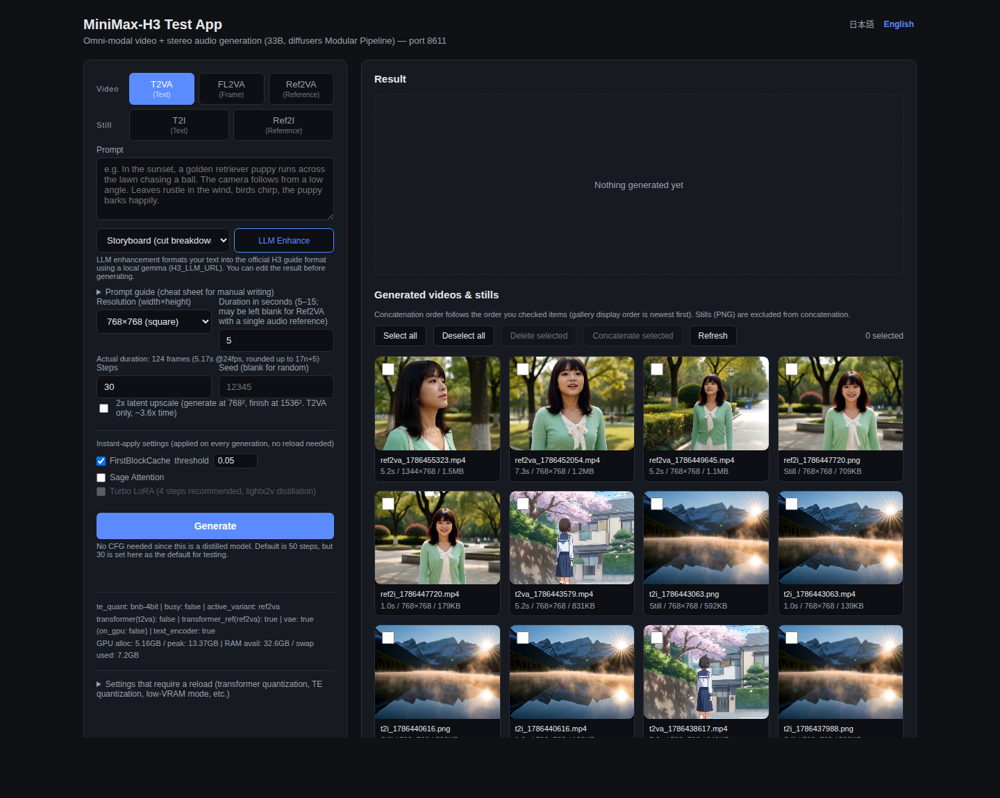

# minimax-h3

[日本語](README.md) | **English**

**MiniMax H3 (Hailuo 3.0) — running the 33B omnimodal model that generates video + stereo audio in a single denoise pass, on consumer-tier GPUs.**
From text, an image reference or an audio reference it produces **video + stereo audio**, and it can also emit still images only (T2I / Ref2I).
It is built on the diffusers Modular Pipeline (PR #14355, pinned to commit **f37ab93**).
**Verified on a single 6GB card, on two 8GB cards and on a single real RTX 4060 Ti 16GB**, and a single 32GB card reaches realtime conversational generation (0.95x real time).



*A single-page browser UI. Five modes on tabs (video: **T2VA** = text / **FL2VA** = frame / **Ref2VA** = reference; still image: **T2I** / **Ref2I**). The lower section is a gallery of outputs, from which checked videos can be concatenated and exported. Prompts can be enhanced into the official H3 guide format via a local LLM, and FirstBlockCache / Sage / Turbo / quantization / low-VRAM mode are toggled from this panel **without a restart**. Includes a Japanese/English switch.*

## Highlights

- **Runs on consumer GPUs**: block-wise streaming of the int8 transformer (`H3_LOWVRAM=group`), a projected TE (Qwen3-VL-4B + a linear map standing in for the 32B TE), an fp16 video VAE and streaming of the TE / token_refiner / VAE decoder bring 768² x 5 s down to **4.6GB** and 1024² x 5 s to **6.4GB**. With 32GB or 16GB of host RAM the weights are streamed straight from the quantized cache.
- **Fixed costs removed**: the bottleneck was never the denoise but the model load/free. A resident transformer, quantized caches, pinned parking and a KV cache for the reference prefix give t2i 9.7 s / t2va (5 s) 44 s on the 48GB tier and t2i 7.4 s on the 96GB tier.
- **Speed options**: FirstBlockCache, SageAttention (sm_120), the lightx2v turbo LoRA (4 / 8-step distillation), ck-w4a8 quantization and the AdaLN-pruned transformer_ref.
- **Five generation modes plus batches**: T2VA / FL2VA / Ref2VA (ordered references: up to 9 images, 3 videos and 3 audio clips; lip sync from an audio reference) / T2I / Ref2I. Still images and reference-conditioned videos batch up to 24 scenes.
- **LLM prompt enhancement**: a local LLM (OpenAI-compatible API) rewrites the input into the format of the official `h3-prompt-writing` skill, with a verify + repair loop before generation.
- **Quality guarded**: diffusers upgrades and quantized caches are regression-checked by identical-seed MD5.

## Supported GPUs (at a glance)

Measured for t2va 5 s at 768². The detailed rows (80GB / 18GB / 12GB tiers etc.) and the measurement conditions are in [docs/FEATURES.en.md](docs/FEATURES.en.md#vram-configurations-and-residency).

| GPU | Startup flags | Result |
|---|---|---|
| 96GB | (none = default) | peak 92GB / about 160 s |
| 48GB tier | `H3_LOWVRAM=1 H3_TE_PRUNE=1 H3_TE_DEVICE=cuda:1 H3_VIDEO_VAE_FP16=1 H3_KEEP_TRANSFORMER=1` (recommended two-card setup) | t2i 9.7 s / t2va 44.2 s (turbo, 4 steps) |
| single 24 / 32GB | ck-w4a8 + AdaLN-pruned + pinned parking ([details](docs/FEATURES.en.md#oct-2026-update-realtime-conversational-generation-on-a-single-24gb32gb-gpu)) | 320×448, 141 frames in **5.57 s = 0.95x real time** (32GB) / 7.1 s (24GB) |
| 32GB tier | `H3_LOWVRAM=group` | peak 28.7GB / about 280 s |
| single 16GB (real 4060 Ti) | `H3_LOWVRAM=group H3_TE_PROJ=NicoLab28/ClipProj-MiniMax-H3 H3_VIDEO_VAE_FP16=1` | peak 11.4GB * |
| single 6GB / 8GB | the row above + `H3_TE_STREAM=1 H3_TE_DIET=1` | 768²: 4.62GB / 1024²: 6.41GB (272 / 552 s on the 48GB box) |
| 8GB x 2 | single-16GB flags + `H3_TE_DEVICE=cuda:1` | peak 7.23GB * |

\* Times are left out of the table because they depend heavily on the box. As measured (PCIe Gen3 x4 slot + an sm_89 4060 Ti, SDPA, 30 steps) both the single 16GB and the 8GB x 2 setups took about 25 minutes for t2va 5 s, but almost all of it is the per-step weight transfer (about 51 s/step); **on Gen4 x16 the transfer drops to about 1/8, so expect roughly 4-5 minutes** (the same low-VRAM configuration measured on GPU0 of the 48GB box gives 272 s for 768² x 5 s). Cards other than sm_120 also need `H3_ATTN_BACKEND=default` (the default sage build is sm_120-only). Turbo (`H3_TURBO_LORA=1`) works in group mode as well: on an A4000 16GB (Gen4 x4) t2va 5 s at 768² went from 790 s at 30 steps to 151 s at 4 steps. With the 8GB-tier flags (`H3_TE_STREAM=1 H3_TE_DIET=1`, VAE decoder streaming) under an 8GB allocator cap, 768² completed in 209 s at a 3.08GB peak and 1024² in 376 s at a 3.73GB peak (the denoise peak of 3.1-3.7GB also fits a 6GB card). In the same setup ref2va (one image reference, 768², 5 s) took 299 s at 4 turbo steps with a 3.0GB peak, and fl2va (first frame given, 768², 5 s) 225 s with a 3.4GB peak. That low-VRAM setups "run but slowly", and that crossing configurations changes the composition even at the same seed (a trajectory divergence, not degradation), is covered in the [performance overview](docs/FEATURES.en.md#performance-overview).

## Installation

### Requirements

| | Requirement |
|---|---|
| GPU | Minimum: a **single 6GB card** (768²) / **single 8GB** (1024²) / **single 16GB** (all features). **48GB tier** recommended for comfortable use |
| Host RAM | 64GB or more recommended (`H3_LOWVRAM=group` pins ~34GB of int8 weights, so 48GB+ free is needed). Below 48GB the weights are streamed from the quantized cache instead (`H3_GROUP_STREAM_HOST=file`; on a 32GB box 1K runs at the same speed, 512² about 2x slower) |
| Disk | About 145GB (T2VA / FL2VA only) / about 207GB (if Ref2VA is also used) |
| CUDA | 12.8 series (to match torch 2.9.0+cu128). If building SageAttention, `nvcc` must be the same series |
| Python | 3.12 |
| Other | `ffmpeg` (used for gallery concatenation and info retrieval; generation itself works without it) |

### Steps

```bash
git clone https://github.com/animede/Diffusers_minimax-h3.git
cd Diffusers_minimax-h3
scripts/install.sh
```

`scripts/install.sh` creates `venv/`, installs [requirements.txt](requirements.txt) and finally prints the torch / diffusers / transformers versions. It needs only Python 3.12 and `git`; nothing is compiled against CUDA, so it finishes in a few minutes. Add `--sage` to also install SageAttention (below).

<details>
<summary>Installing by hand (same contents as requirements.txt)</summary>

```bash
python3.12 -m venv venv

# PyTorch (cu128)
venv/bin/pip install torch==2.9.0 --index-url https://download.pytorch.org/whl/cu128

# ============================================================================
# [IMPORTANT] Pin diffusers to the verified commit f37ab93 (the final merged form of PR #14355).
#             Do not install the PyPI release or the latest main (see the note below)
# ============================================================================
venv/bin/pip install "git+https://github.com/huggingface/diffusers.git@f37ab93e621d5ce206c9662e8291ca8b67d9c555"

# transformers 5.14.1 or later is required (5.1.0 lacks Qwen3VLProcessor.create_mm_token_type_ids)
venv/bin/pip install "transformers==5.14.1" accelerate==1.12.0 safetensors huggingface_hub

# Video/audio muxing and the Web API
venv/bin/pip install av==16.0.1 fastapi==0.104.1 "uvicorn==0.24.0" python-multipart pillow numpy

# 4bit quantization of text_encoder (required for the default H3_TE_QUANT=bnb-4bit)
venv/bin/pip install bitsandbytes==0.49.0

# Only if using int8 quantization for the transformer (H3_TRANSFORMER_QUANT=int8 / H3_LOWVRAM)
#   0.18+ requires torch>=2.11, so pin to 0.17.0
venv/bin/pip install torchao==0.17.0
```

</details>

> **About upgrading diffusers**: installing it is just the one line above (pure Python, no build; it takes well under a minute with `git` available). Care is needed only **when upgrading diffusers later**: a newer version can change the compute path and therefore the output, so keep the commit pinned. The move to f37ab93 itself was made only after every path (t2i / t2va / batch / ref2va / reference batch) was verified equivalent to the old pin abc5e9b by identical-seed MD5. Any further upgrade should go through the same regression check (`scripts/run_regression.py` with the baselines in docs/internal). Not needed for ordinary use.

### SageAttention (optional, enabled by default)

The default `H3_ATTN_BACKEND=sage` needs a build for sm_120 (there is no prebuilt Linux wheel). **If you do not build it, start with `H3_ATTN_BACKEND=default`** (denoise is about 12% slower; no functional difference).

```bash
CUDA_HOME=/usr/local/cuda-12.8 scripts/install.sh --sage     # or scripts/build_sageattention.sh
```

`--sage` installs a prebuilt wheel from `third_party/wheels/` if one is there, and otherwise builds from source.

> **Always limit the build parallelism** (the script runs with `MAX_JOBS=4 NVCC_THREADS=2` under a systemd-run memory cap). Unbounded parallel nvcc exhausts host RAM and OOMs the whole system.

### Obtaining the model

`MiniMaxAI/MiniMax-H3` is 498.6GB, but T2VA / FL2VA only need `transformer/` (66.3GB) + `text_encoder/` (66.7GB) + `vae/` (10.4GB) + `audio_vae/` (0.6GB) + configs, **about 144GB**. Fetch `transformer_ref/` (Ref2VA, 66.3GB) only when needed, and **never `snapshot_download` the whole repo**.

```bash
venv/bin/python scripts/download_t2va.py
```

It uses `allow_patterns` internally to fetch only the needed subfolders; `logs/du_monitor.log` tracks the cache size while downloading. When the bf16 transformer / transformer_ref weights are not cached, they are downloaded only with `H3_ALLOW_WEIGHT_DOWNLOAD=1` (the default fails with a hint).

## Starting

```bash
venv/bin/python -m uvicorn app:app --host 0.0.0.0 --port 8611
```

With nothing set, **`H3_PROFILE=auto`** picks the 96 / 80 / 48 / 32 / 16 / 8GB-tier defaults (the same flags as the launch examples below) from the compute GPU's total VRAM. Setting any of the main profile variables (`H3_LOWVRAM`, `H3_TE_PROJ`, ...) switches to manual mode and nothing is filled in automatically. When the default sage build cannot be used (a GPU other than sm_120, or sageattention not installed) `H3_ATTN_BACKEND=default` is also set automatically. The chosen tier is shown in `/api/status` under `profile` and in the startup log.

Open `http://<host>:8611/` in a browser. The first start takes a few minutes to load the models (by default the TE is NF4-quantized and kept on the GPU). `run.sh` is the launcher used by the diffusers-movie-server integration: it starts the same server on internal port 8631 with the conversation-oriented defaults (turbo LoRA etc.).

Launch examples per VRAM tier:

```bash
# Real 16GB, single card (e.g. an sm_89 4060 Ti; anything other than sm_120 needs H3_ATTN_BACKEND=default)
H3_LOWVRAM=group H3_TE_PROJ=NicoLab28/ClipProj-MiniMax-H3 H3_VIDEO_VAE_FP16=1 \
  H3_ATTN_BACKEND=default \
  venv/bin/python -m uvicorn app:app --host 0.0.0.0 --port 8611

# 6GB / 8GB single card (the 16GB flags plus TE streaming and diet; H3_CACHE=none goes lower still)
H3_LOWVRAM=group H3_TE_PROJ=NicoLab28/ClipProj-MiniMax-H3 H3_VIDEO_VAE_FP16=1 H3_TE_STREAM=1 H3_TE_DIET=1 \
  H3_ATTN_BACKEND=default \
  venv/bin/python -m uvicorn app:app --host 0.0.0.0 --port 8611

# 8GB x 2 (TE on the second GPU)
H3_LOWVRAM=group H3_TE_PROJ=NicoLab28/ClipProj-MiniMax-H3 H3_VIDEO_VAE_FP16=1 \
  H3_ATTN_BACKEND=default H3_TE_DEVICE=cuda:1 \
  venv/bin/python -m uvicorn app:app --host 0.0.0.0 --port 8611

# 32GB tier
H3_LOWVRAM=group H3_TE_PRUNE=1 venv/bin/python -m uvicorn app:app --host 0.0.0.0 --port 8611

# 48GB tier (recommended: full speedups; drop H3_TE_DEVICE when using ref2va)
H3_LOWVRAM=1 H3_TE_PRUNE=1 H3_TE_DEVICE=cuda:1 H3_VIDEO_VAE_FP16=1 H3_KEEP_TRANSFORMER=1 \
  venv/bin/python -m uvicorn app:app --host 0.0.0.0 --port 8611

# 96GB tier (everything resident, no env)
venv/bin/python -m uvicorn app:app --host 0.0.0.0 --port 8611
```

The full environment set and caveats for realtime conversational generation on a single 24 / 32GB card (ck-w4a8 quantization + pinned parking) are in [docs/FEATURES.en.md](docs/FEATURES.en.md#oct-2026-update-realtime-conversational-generation-on-a-single-24gb32gb-gpu).

To verify operation before using the UI, run the regression probe (writes `outputs/probe_t2va.mp4` and `outputs/probe_report.json`):

```bash
venv/bin/python scripts/probe_t2va.py
```

## Usage

### UI

- The upper tab row switches between the video modes (T2VA / FL2VA / Ref2VA), the lower row between the still-image modes (T2I / Ref2I). Ref2VA takes multiple files; selection order = reference order.
- The checkboxes directly above the generate button (FirstBlockCache, Sage, Turbo) apply per request. Quantization, low-VRAM mode, TE placement and the like live in the collapsible header and take effect with "Apply (reload)".
- The "LLM enhance" button reformats the prompt in `storyboard` / `brief` / `h3-official` / `translate` mode (needs a local LLM).
- The gallery at the bottom lists outputs, deletes them and concatenates the checked videos.

### API

| Endpoint | What it does |
|---|---|
| `POST /api/t2va` | Text to video + audio. `prompt`, `resolution` (`768x768` / `768x1344` / `1344x768`), `seconds` (5-15), `num_inference_steps`, `seed` |
| `POST /api/fl2va` | The above plus `image` / `last_image` (at least one) |
| `POST /api/ref2va` | Reference-conditioned generation. `references` (up to 9 images, 3 videos, 3 audio clips; order matters). With exactly one audio reference, `seconds=0` uses the audio length. `still=1` + `frames` gives a reference-conditioned still (ref2i) |
| `POST /api/t2i` | Still image. `frames` (default 22, or 5) instead of `seconds`. Saves an ultra-short mp4 and the center-frame PNG |
| `POST /api/t2i_batch` / `POST /api/ref2i_batch` / `POST /api/ref2va_batch` | Batch generation. Repeat `prompts` per scene (up to 24). The reference variants share `references`; `ref2va_batch` requires a common `seconds` |
| `POST /api/prompt/enhance` | LLM prompt enhancement. `{text, mode, seconds, task, lang}` |
| `GET /api/status` / `GET /api/progress` / `POST /api/interrupt` | Load state and VRAM / RAM, progress of the running job, interrupt |
| `GET /api/settings` / `POST /api/settings/apply` | Read and apply (reload) the settings switchable from the UI |
| `POST /api/admin/unload` / `POST /api/admin/reload` | Free and reload the models |
| `GET /api/outputs` / `POST /api/outputs/delete` / `POST /api/outputs/concat` | Gallery listing, deletion and concatenation |

All endpoints take multipart/form-data. Each mode is described in [Generation modes in docs/FEATURES.en.md](docs/FEATURES.en.md#generation-modes).

## Main environment variables

Defaults shown. Most **can also be toggled from the UI**, so set them only to change them permanently. The full list with measurements is in [docs/FEATURES.en.md](docs/FEATURES.en.md).

| Variable | Default | Meaning |
|---|---|---|
| `H3_PROFILE` | `auto` | Automatic main profile. `auto` picks a tier from total VRAM only when none of the main profile variables is set / `96gb`..`8gb` forces a tier (use this when emulating a smaller card with `H3_VRAM_LIMIT_GB`) / `off` |
| `H3_LOWVRAM` | `0` | `1` = 48GB-tier phase cycling / `group` = block offload for the 32GB tier and below (streams the int8 weights block by block) |
| `H3_TRANSFORMER_QUANT` | `none` | `int8` shrinks the transformer from 66.3GB to 34GB. `ck-w4a8` uses ComfyUI's W4A8 kernel (needs `comfy-kitchen`) |
| `H3_TE_QUANT` | `bnb-4bit` | text_encoder quantization (`none` = bf16, 66.7GB) |
| `H3_TE_PRUNE` | `0` | Remove unused upper layers of the TE (output unchanged, -3.6GB) |
| `H3_TE_PROJ` | (off) | **Projected TE**: replaces the 32B TE with Qwen3-VL-4B + a linear map (repo id or .safetensors path; quality is an approximation) |
| `H3_TE_PROJ_QUANT` | `bnb-4bit` | Quantization of the projected TE (NF4 = 3.11GB; `none` = bf16 8.88GB / `bnb-8bit`) |
| `H3_TE_DEVICE` | (off) | Park the TE on a second GPU (e.g. `cuda:1`; the 32B TE needs a 20GB-class card, the projected TE fits an 8GB-class one) |
| `H3_TE_STREAM` / `H3_TE_DIET` | `0` / `0` | Streaming and diet of the projected TE / token_refiner (the key to the 6GB / 8GB setups) |
| `H3_GROUP_STREAM` / `H3_GROUP_STREAM_HOST` | `own` / `auto` | Weight transfer scheme in group mode. `HOST` streams straight from the quantized cache files (`file`) when the host has less than 48GB of RAM |
| `H3_VIDEO_VAE_FP16` | `0` | fp16-ify the video VAE (reduces the decode peak; required at 16GB and below) |
| `H3_KEEP_TRANSFORMER` | `0` | Keep the transformer resident, removing the reload fixed cost |
| `H3_PRUNED` / `H3_PRUNED_QUANT` | `0` / `int8wo` | Load the AdaLN-pruned transformer_ref for ref2va (requires `H3_TRANSFORMER_QUANT=int8`) and its quantization scheme |
| `H3_CACHE` / `H3_CACHE_THRESHOLD` | `fbc` / `0.05` | FirstBlockCache (denoise -25%; measured ineffective on the int8+SDPA trajectory) |
| `H3_ATTN_BACKEND` | `sage` | The sage build is sm_120-only. **Any other GPU must use `default` (SDPA)** |
| `H3_TURBO_LORA` | `0` | lightx2v 4 / 8-step distilled LoRA (downloads about 780MB on first use). Works in `group` too (needs the in-house streamer `H3_GROUP_STREAM=own` and the flag at startup; not with `file` streaming on hosts under 48GB RAM) |
| `H3_ALLOW_WEIGHT_DOWNLOAD` | `0` | Download the bf16 weights (~66GB each) from HF only when `1` if they are not cached |
| `H3_LLM_URL` / `H3_LLM_API_KEY` | `http://127.0.0.1:64660` / none | Local LLM for prompt enhancement and its API key (the key is also read from the git-ignored `config.local.env`) |

## Documentation

| Document | Contents |
|---|---|
| [docs/FEATURES.en.md](docs/FEATURES.en.md) | **Features and settings in detail**: how each environment variable works, its preconditions and measurements, per-VRAM-tier configurations, generation modes, UI, LLM enhancement |
| [docs/TECHNICAL_OVERVIEW.en.md](docs/TECHNICAL_OVERVIEW.en.md) | **Technical overview**: architecture, how the techniques are integrated, handling per VRAM tier, performance, configuration reference |
| [docs/RESIDENCY.en.md](docs/RESIDENCY.en.md) | **Residency reference**: what is on the GPU at each phase, per mode and setting |
| [docs/COMMUNITY_IMPROVEMENTS.en.md](docs/COMMUNITY_IMPROVEMENTS.en.md) | Decisions on community improvements (adopted / investigated and declined / reimplemented in-house) |
| [docs/HISTORY.en.md](docs/HISTORY.en.md) | **Development history**: dated work log, bugs and fixes, A/B measurements, backlog |
| [docs/internal/TECHNICAL_REPORT.en.md](docs/internal/TECHNICAL_REPORT.en.md) | Internal document: the background to design decisions from 2026-08-04 to 08-08 and the pitfalls hit on real hardware |
| [docs/internal/regression_baselines_dev96.json](docs/internal/regression_baselines_dev96.json) | Regression baselines for diffusers upgrades (run with `scripts/run_regression.py`) |

For a conversational application built on this server see [Realtime_Narration_Video](https://github.com/animede/Realtime_Narration_Video) and the voice client [Realtime_Conversation_Video](https://github.com/animede/Realtime_Conversation_Video); the production integration lives in [diffusers-movie-server](https://github.com/animede/diffusers-movie-server).

## Layout

```
minimax-h3/
├── app.py                 # FastAPI server (port 8611)
├── run.sh                 # launcher for the diffusers-movie-server integration (port 8631)
├── core/
│   ├── runner.py          # ModularPipeline loading / generation logic
│   ├── blockstream.py     # windowed prefetch streamer for transformer blocks (H3_GROUP_STREAM=own)
│   ├── filestream.py      # streams weights straight from the quantized cache files (H3_GROUP_STREAM_HOST=file)
│   ├── leanblock.py       # memory-lean block forward
│   ├── attnchunk.py       # query-chunked / head-grouped attention
│   ├── testream.py        # streaming of the projected TE and token_refiner
│   ├── vaecache.py        # fp16 cache of the VAE decoder
│   ├── pruned.py          # AdaLN-pruned transformer_ref and its quantized cache
│   ├── adaln_precompute.py, h3_cudagraph.py
│   ├── llm.py, prompt_check.py   # LLM prompt enhancement and verification
│   ├── settings.py, gallery.py
├── static/index.html      # single-page UI (ja / en)
├── scripts/               # download, regression and probe scripts
├── docs/                  # documentation (table above)
├── models/                # quantized caches etc. (git-ignored)
├── outputs/, logs/        # outputs and logs (git-ignored)
└── venv/                  # dedicated venv (git-ignored)
```

## License

Copyright holder of the source code in this repository: © 2026 YUZUKI (animede). Keep the copyright notice and the contents of [NOTICE](NOTICE) when redistributing, as required by Apache-2.0 section 4.

**This repository's code is licensed under Apache License 2.0** ([LICENSE](LICENSE)). Model weights are not included.

The licenses of the models / weights used must each be followed separately:

| Target | License |
|---|---|
| MiniMax-H3's own weights | MiniMax Community License (free for non-commercial use; commercial use free up to $20M/year revenue, credit required) |
| Turbo LoRA (`larryvrh/MiniMax-H3-Turbo-Lora`, `lightx2v/Minimax-h3-Turbo`) | Apache-2.0 |
| Qwen3-VL-32B (text_encoder) / Qwen3-VL-4B (projected TE) | Follows Qwen's official license |
| diffusers / transformers / torchao / SageAttention etc. | Each package's own license |
