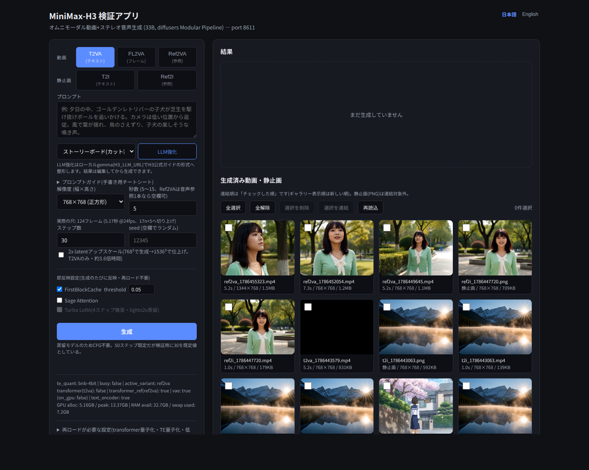

# minimax-h3

**日本語** | [English](README.en.md)

**MiniMax H3 (Hailuo 3.0) — 動画+ステレオ音声を1回のデノイズで同時生成する 33B オムニモーダルモデルを、普及帯 GPU で動かす検証アプリ。**
テキスト / 画像参照 / 音声参照から **動画+ステレオ音声** を生成し、静止画のみ(T2I / Ref2I)も出せる。
基盤は diffusers の Modular Pipeline(PR #14355、コミット **f37ab93** にピン留め)。
**6GB 単体・8GB×2・実 RTX 4060 Ti 16GB 単体で動くことを実測済み**で、32GB 単騎ならリアルタイム会話生成(実時間の 0.95 倍)まで到達している。



*ブラウザから使う単一ページ UI。5 つのモードをタブで切替(動画: **T2VA**=テキスト / **FL2VA**=フレーム / **Ref2VA**=参照、静止画: **T2I** / **Ref2I**)。下段は生成物ギャラリーで、チェックした動画を連結して書き出せる。プロンプトはローカル LLM で H3 公式ガイドの形式へ強化でき、FirstBlockCache・Sage・Turbo・量子化・低 VRAM モードなどは**再起動なしで**このパネルから切替。日英切替あり。*

## 特徴

- **普及帯 GPU で動く**: transformer int8 のブロック単位ストリーミング(`H3_LOWVRAM=group`)、投影 TE(Qwen3-VL-4B + 線形写像で 32B TE を代替)、video VAE の fp16 化、TE / token_refiner / VAE デコーダのストリーミングにより、768²×5 秒が **4.6GB**、1024²×5 秒が **6.4GB** で完走する。ホスト RAM が 32GB / 16GB でも量子化キャッシュから直接流せる。
- **固定費の削減**: 律速はデノイズではなく「モデルの load/free」だった。transformer 常駐・量子化済みキャッシュ・pinned 退避・参照 prefix の KV キャッシュで、48GB 級で t2i 9.7 秒 / t2va 5 秒 44 秒、96GB 級で t2i 7.4 秒。
- **高速化オプション**: FirstBlockCache、SageAttention(sm_120)、lightx2v turbo LoRA(4 / 8 ステップ蒸留)、ck-w4a8 量子化、AdaLN-pruned 版 transformer_ref。
- **5 つの生成モードとバッチ**: T2VA / FL2VA / Ref2VA(画像最大 9・動画最大 3・音声最大 3 の順序付き参照、音声参照でリップシンク)/ T2I / Ref2I。静止画・参照付き動画は最大 24 場面のバッチ生成に対応。
- **LLM プロンプト強化**: ローカル LLM(OpenAI 互換 API)で入力を H3 公式スキル `h3-prompt-writing` の形式へ整形。生成前の検証 + 修復ループつき。
- **品質の担保**: diffusers の更新や量子化キャッシュの導入は、同一 seed の MD5 一致で回帰確認している。

## 対応 GPU(早見表)

t2va 5 秒・768² の実測。詳細な行(80GB / 18GB / 12GB 級など)と測定条件は [docs/FEATURES.md](docs/FEATURES.md#vram-構成と常駐設計) を参照。

| GPU | 起動時の指定 | 結果 |
|---|---|---|
| 96GB | (指定なし = 既定) | peak 92GB / 約 160 秒 |
| 48GB 級 | `H3_LOWVRAM=1 H3_TE_PRUNE=1 H3_TE_DEVICE=cuda:1 H3_VIDEO_VAE_FP16=1 H3_KEEP_TRANSFORMER=1`(2 枚構成の推奨) | t2i 9.7 秒 / t2va 44.2 秒(turbo 4 ステップ) |
| 24 / 32GB 単騎 | ck-w4a8 + AdaLN-pruned + pinned 退避の一式([詳細](docs/FEATURES.md#2026-10-更新-24gb32gb-単騎でリアルタイム会話生成)) | 320×448・141f が **5.57 秒 = 実時間の 0.95 倍**(32GB)/ 7.1 秒(24GB) |
| 32GB 級 | `H3_LOWVRAM=group` | peak 28.7GB / 約 280 秒 |
| 16GB 単体(実 4060 Ti) | `H3_LOWVRAM=group H3_TE_PROJ=NicoLab28/ClipProj-MiniMax-H3 H3_VIDEO_VAE_FP16=1` | peak 11.4GB ※ |
| 6GB / 8GB 単体 | 上の行 + `H3_TE_STREAM=1 H3_TE_DIET=1` | 768²: 4.62GB / 1024²: 6.41GB(48GB 機で 272 / 552 秒) |
| 8GB×2 | 16GB 単体の指定 + `H3_TE_DEVICE=cuda:1` | peak 7.23GB ※ |

※ 時間は測定した箱に強く依存するため表には載せない。実測(PCIe Gen3 x4 スロット + sm_89 の 4060 Ti、SDPA、30 ステップ)では 16GB 単体・8GB×2 とも t2va 5 秒に約 25 分かかったが、そのほとんどは毎ステップの重み転送(約 51 秒/ステップ)で、**Gen4 x16 なら転送は約 1/8 になり 4〜5 分程度に収まる見込み**(同じ低 VRAM 構成を 48GB 機の GPU0 で測ると 768²×5 秒が 272 秒)。sm_120 以外のカードは `H3_ATTN_BACKEND=default` も必要(既定の sage は sm_120 専用ビルド)。turbo(`H3_TURBO_LORA=1`)は group でも使え、A4000 16GB(Gen4 x4)で t2va 5 秒・768² が 30 ステップ 790 秒 → 4 ステップ 151 秒だった。8GB 級の指定(`H3_TE_STREAM=1 H3_TE_DIET=1`、VAE デコーダのストリーミング)に 8GB の上限を切った模擬では 768² が 209 秒・ピーク 3.08GB、1024² が 376 秒・ピーク 3.73GB で完走した(デノイズ中のピークは 3.1〜3.7GB で、6GB 級にも収まる値)。同じ構成で ref2va(画像参照 1 枚、768²・5 秒)も turbo 4 ステップで 299 秒・ピーク 3.0GB、fl2va(先頭フレーム指定、768²・5 秒)は 225 秒・ピーク 3.4GB。低 VRAM 構成は「動くが遅い」こと、構成をまたぐと同一 seed でも構図が変わる(劣化ではなく軌道の分岐)ことは [性能の概要](docs/FEATURES.md#性能の概要) に詳しい。

## インストール

### 必要なもの

| | 要件 |
|---|---|
| GPU | 最小: **6GB 単体**(768²)/ **8GB 単体**(1024²)/ **16GB 単体**(全機能)。快適動作は **48GB 級**を推奨 |
| ホスト RAM | 64GB 以上を推奨(`H3_LOWVRAM=group` は int8 重み ~34GB をピン留めするため 48GB 以上の空きが要る)。48GB 未満では量子化キャッシュから直接流す方式に自動で切り替わる(`H3_GROUP_STREAM_HOST=file`、32GB 機で 1K は同速・512² は約 2 倍) |
| ディスク | 約 145GB(T2VA / FL2VA のみ)/ 約 207GB(Ref2VA も使う場合) |
| CUDA | 12.8 系(torch 2.9.0+cu128 に合わせる)。SageAttention をビルドするなら `nvcc` も同系統 |
| Python | 3.12 |
| その他 | `ffmpeg`(ギャラリーの連結・情報取得に使用。無くても生成自体は動く) |

### 手順

```bash
git clone https://github.com/animede/Diffusers_minimax-h3.git
cd Diffusers_minimax-h3
scripts/install.sh
```

`scripts/install.sh` は `venv/` を作って [requirements.txt](requirements.txt) を入れ、最後に torch / diffusers / transformers のバージョンを表示する。必要なのは Python 3.12 と `git` だけで、CUDA のビルドは発生しない(数分で終わる)。`--sage` を付けると SageAttention も入れる(下記)。

<details>
<summary>手動で入れる場合(requirements.txt と同じ内容)</summary>

```bash
python3.12 -m venv venv

# PyTorch (cu128)
venv/bin/pip install torch==2.9.0 --index-url https://download.pytorch.org/whl/cu128

# ============================================================================
# 【重要】diffusers は検証済みコミット f37ab93(PR #14355 のマージ最終形)に固定する。
#        pip install diffusers(PyPI 版)や最新 main を入れないこと(下の注記を参照)
# ============================================================================
venv/bin/pip install "git+https://github.com/huggingface/diffusers.git@f37ab93e621d5ce206c9662e8291ca8b67d9c555"

# transformers は 5.14.1 以上が必須(5.1.0 には Qwen3VLProcessor.create_mm_token_type_ids が無い)
venv/bin/pip install "transformers==5.14.1" accelerate==1.12.0 safetensors huggingface_hub

# 動画/音声の多重化と Web API
venv/bin/pip install av==16.0.1 fastapi==0.104.1 "uvicorn==0.24.0" python-multipart pillow numpy

# text_encoder の 4bit 量子化(既定の H3_TE_QUANT=bnb-4bit に必要)
venv/bin/pip install bitsandbytes==0.49.0

# transformer の int8 量子化を使う場合のみ(H3_TRANSFORMER_QUANT=int8 / H3_LOWVRAM)
#   0.18 以降は torch>=2.11 を要求するため 0.17.0 を固定する
venv/bin/pip install torchao==0.17.0
```

</details>

> **diffusers の更新について**: インストール自体は上の 1 行で済む(純 Python なのでビルドは無く、`git` があれば数十秒で入る)。注意が要るのは**あとから diffusers を上げるとき**で、計算経路が変わって出力が変わりうるため、コミット固定のまま使うこと。f37ab93 への追従も、全経路(t2i / t2va / バッチ / ref2va / 参照バッチ)が旧ピン abc5e9b と同一 seed の MD5 で等価であることを確認してから行った。さらに上げる場合は同じ回帰確認(`scripts/run_regression.py` と docs/internal の基準値)を踏む。普通に使うだけなら不要。

### SageAttention(任意、既定で有効)

既定の `H3_ATTN_BACKEND=sage` を使うには sm_120 向けのビルドが要る(Linux 向けの事前ビルド wheel は無い)。**ビルドしない場合は `H3_ATTN_BACKEND=default` を指定して起動する**(デノイズが約 12% 遅くなるだけで機能に影響はない)。

```bash
CUDA_HOME=/usr/local/cuda-12.8 scripts/install.sh --sage     # または scripts/build_sageattention.sh
```

`--sage` は `third_party/wheels/` にビルド済み wheel があればそれを入れ、無ければソースビルドする。

> ビルドは**必ず並列数を制限する**(スクリプトは `MAX_JOBS=4 NVCC_THREADS=2` + systemd-run のメモリ上限付きで実行する)。無制限の並列 nvcc はホスト RAM を食い潰してシステム全体を OOM させる。

### モデルの取得

`MiniMaxAI/MiniMax-H3` は 498.6GB あるが、T2VA / FL2VA には `transformer/`(66.3GB)+ `text_encoder/`(66.7GB)+ `vae/`(10.4GB)+ `audio_vae/`(0.6GB)+ 設定類の**約 144GB** で足りる。`transformer_ref/`(Ref2VA 用、66.3GB)は必要なときだけ取得し、**丸ごと `snapshot_download` しないこと**。

```bash
venv/bin/python scripts/download_t2va.py
```

内部で `allow_patterns` を使って必要なサブフォルダのみを取得する。ダウンロード中は `logs/du_monitor.log` でキャッシュサイズを監視できる。bf16 の transformer / transformer_ref がキャッシュに無いときは、`H3_ALLOW_WEIGHT_DOWNLOAD=1` のときだけ自動取得する(既定はエラーで案内)。

## 起動

```bash
venv/bin/python -m uvicorn app:app --host 0.0.0.0 --port 8611
```

何も指定しなければ **`H3_PROFILE=auto`** が計算用 GPU の総 VRAM から 96 / 80 / 48 / 32 / 16 / 8GB 級の既定値一式(下の起動例と同じ内容)を選ぶ。`H3_LOWVRAM` や `H3_TE_PROJ` など主プロファイル系の変数をひとつでも指定すると手動扱いになり、自動では何も入れない。sage が使えない GPU(sm_120 以外)や未インストールのときは `H3_ATTN_BACKEND=default` も自動で入る。選ばれた級は `/api/status` の `profile` と起動ログで確認できる。

ブラウザで `http://<host>:8611/` を開く。初回起動時はモデルのロード(既定では TE を NF4 量子化して GPU 常駐)に数分かかる。`run.sh` は diffusers-movie-server 統合用の起動スクリプトで、内部ポート 8631 と会話用途の既定値(turbo LoRA 等)を設定したうえで同じサーバを起動する。

VRAM 級別の起動例:

```bash
# 実16GB 単体(sm_89 の 4060 Ti など。sm_120 以外は H3_ATTN_BACKEND=default が必須)
H3_LOWVRAM=group H3_TE_PROJ=NicoLab28/ClipProj-MiniMax-H3 H3_VIDEO_VAE_FP16=1 \
  H3_ATTN_BACKEND=default \
  venv/bin/python -m uvicorn app:app --host 0.0.0.0 --port 8611

# 6GB / 8GB 単体(16GB の指定に TE のストリーミングと削減を足す。さらに下げるなら H3_CACHE=none)
H3_LOWVRAM=group H3_TE_PROJ=NicoLab28/ClipProj-MiniMax-H3 H3_VIDEO_VAE_FP16=1 H3_TE_STREAM=1 H3_TE_DIET=1 \
  H3_ATTN_BACKEND=default \
  venv/bin/python -m uvicorn app:app --host 0.0.0.0 --port 8611

# 8GB×2(TE を 2 枚目 GPU へ)
H3_LOWVRAM=group H3_TE_PROJ=NicoLab28/ClipProj-MiniMax-H3 H3_VIDEO_VAE_FP16=1 \
  H3_ATTN_BACKEND=default H3_TE_DEVICE=cuda:1 \
  venv/bin/python -m uvicorn app:app --host 0.0.0.0 --port 8611

# 32GB 級
H3_LOWVRAM=group H3_TE_PRUNE=1 venv/bin/python -m uvicorn app:app --host 0.0.0.0 --port 8611

# 48GB 級(推奨: 高速化フル。ref2va を使うときは H3_TE_DEVICE を外す)
H3_LOWVRAM=1 H3_TE_PRUNE=1 H3_TE_DEVICE=cuda:1 H3_VIDEO_VAE_FP16=1 H3_KEEP_TRANSFORMER=1 \
  venv/bin/python -m uvicorn app:app --host 0.0.0.0 --port 8611

# 96GB 級(全モデル常駐、env なし)
venv/bin/python -m uvicorn app:app --host 0.0.0.0 --port 8611
```

24 / 32GB 単騎でのリアルタイム会話生成(ck-w4a8 量子化 + pinned 退避)の環境変数一式と注意点は [docs/FEATURES.md](docs/FEATURES.md#2026-10-更新-24gb32gb-単騎でリアルタイム会話生成) を参照。

UI より先に動作確認したいときは回帰プローブを使う(`outputs/probe_t2va.mp4` と `outputs/probe_report.json` を出力):

```bash
venv/bin/python scripts/probe_t2va.py
```

## 使い方

### UI

- 上段のタブで動画(T2VA / FL2VA / Ref2VA)、下段のタブで静止画(T2I / Ref2I)を切り替える。Ref2VA は複数ファイル選択で、選択順 = 参照順。
- 生成ボタン直上のチェックボックス(FirstBlockCache・Sage・Turbo)はリクエストごとに即反映。ヘッダの折りたたみにある量子化・低 VRAM モード・TE 配置などは「適用(再ロード)」で切り替える。
- 「LLM 強化」ボタンでプロンプトを `storyboard` / `brief` / `h3-official` / `translate` の各モードで整形できる(ローカル LLM が必要)。
- 下段のギャラリーで生成物の閲覧・削除・チェックした動画の連結ができる。

### API

| エンドポイント | 内容 |
|---|---|
| `POST /api/t2va` | テキスト→動画+音声。`prompt`, `resolution`(`768x768` / `768x1344` / `1344x768`), `seconds`(5〜15), `num_inference_steps`, `seed` |
| `POST /api/fl2va` | 上記に加え `image` / `last_image`(どちらか一方以上) |
| `POST /api/ref2va` | 参照付き生成。`references`(画像最大 9・動画最大 3・音声最大 3、順序が意味を持つ)。音声 1 本だけの参照なら `seconds=0` で音声長に合わせる。`still=1` + `frames` で参照付き静止画(ref2i) |
| `POST /api/t2i` | 静止画。`seconds` の代わりに `frames`(既定 22 / 5)。超短尺 mp4 と中央フレーム PNG を保存 |
| `POST /api/t2i_batch` / `POST /api/ref2i_batch` / `POST /api/ref2va_batch` | バッチ生成。`prompts` を場面数ぶん繰り返す(最大 24)。参照系は共通 `references`、`ref2va_batch` は共通 `seconds` が必須 |
| `POST /api/prompt/enhance` | LLM プロンプト強化。`{text, mode, seconds, task, lang}` |
| `GET /api/status` / `GET /api/progress` / `POST /api/interrupt` | ロード状態と VRAM / RAM、生成中の進捗、生成の中断 |
| `GET /api/settings` / `POST /api/settings/apply` | UI から切り替えられる設定の取得と適用(再ロード) |
| `POST /api/admin/unload` / `POST /api/admin/reload` | モデルの解放と再ロード |
| `GET /api/outputs` / `POST /api/outputs/delete` / `POST /api/outputs/concat` | ギャラリーの一覧・削除・連結 |

すべて multipart/form-data。各モードの詳細は [docs/FEATURES.md の生成モード](docs/FEATURES.md#生成モード) を参照。

## 主な環境変数

既定値を示す。多くは **UI からも切り替えられる**ので、恒久的に変えたいときだけ指定する。全変数と実測値は [docs/FEATURES.md](docs/FEATURES.md) を参照。

| 変数 | 既定 | 意味 |
|---|---|---|
| `H3_PROFILE` | `auto` | 主プロファイルの自動選択。`auto` は主プロファイル系の変数が未指定のときだけ総 VRAM から級を選ぶ / `96gb`〜`8gb` で級を強制(`H3_VRAM_LIMIT_GB` で小さいカードを模擬するときに使う)/ `off` |
| `H3_LOWVRAM` | `0` | `1` = 48GB 級のフェーズ循環 / `group` = 32GB 級以下の block offload(int8 重みをブロック単位でストリーム) |
| `H3_TRANSFORMER_QUANT` | `none` | `int8` で transformer を 66.3→34GB。`ck-w4a8` は ComfyUI の W4A8 カーネル(要 `comfy-kitchen`) |
| `H3_TE_QUANT` | `bnb-4bit` | text_encoder の量子化(`none` は bf16 で 66.7GB) |
| `H3_TE_PRUNE` | `0` | TE の未使用上位レイヤー削除(出力は不変、-3.6GB) |
| `H3_TE_PROJ` | (無効) | **投影 TE**: 32B TE を Qwen3-VL-4B + 線形写像で代替(repo id か .safetensors パス。品質は近似) |
| `H3_TE_PROJ_QUANT` | `bnb-4bit` | 投影 TE の量子化(NF4 で 3.11GB。`none` = bf16 8.88GB / `bnb-8bit`) |
| `H3_TE_DEVICE` | (無効) | TE を 2 枚目 GPU へ常駐(例 `cuda:1`。32B TE は 20GB 級、投影 TE なら 8GB 級) |
| `H3_TE_STREAM` / `H3_TE_DIET` | `0` / `0` | 投影 TE・token_refiner のストリーミングと削減(6GB / 8GB 構成の鍵) |
| `H3_GROUP_STREAM` / `H3_GROUP_STREAM_HOST` | `own` / `auto` | group モードの重み転送方式。`HOST` は搭載 RAM 48GB 未満なら量子化キャッシュのファイルから直接流す(`file`) |
| `H3_VIDEO_VAE_FP16` | `0` | video VAE を fp16 化(デコードのピークを削減。16GB 以下では必須) |
| `H3_KEEP_TRANSFORMER` | `0` | transformer 常駐で再ロード固定費を撤廃 |
| `H3_PRUNED` / `H3_PRUNED_QUANT` | `0` / `int8wo` | ref2va の transformer_ref を AdaLN-pruned 版で読む(`H3_TRANSFORMER_QUANT=int8` 併用必須)と、その量子化方式 |
| `H3_CACHE` / `H3_CACHE_THRESHOLD` | `fbc` / `0.05` | FirstBlockCache(デノイズ -25%。int8+SDPA 軌道では不発の実測あり) |
| `H3_ATTN_BACKEND` | `sage` | sage は sm_120 専用ビルド。**それ以外の GPU は `default`(SDPA)必須** |
| `H3_TURBO_LORA` | `0` | lightx2v の 4 / 8 ステップ蒸留 LoRA(初回に約 780MB を DL)。`group` でも使える(自作ストリーマ `H3_GROUP_STREAM=own` + 起動時指定が条件。ホスト RAM 48GB 未満の `file` ストリーミングとは併用不可) |
| `H3_ALLOW_WEIGHT_DOWNLOAD` | `0` | bf16 重み(各 ~66GB)がキャッシュに無いとき、`1` のときだけ HF から取得 |
| `H3_LLM_URL` / `H3_LLM_API_KEY` | `http://127.0.0.1:64660` / なし | プロンプト強化に使うローカル LLM と API キー(キーは git 管理外の `config.local.env` からも読む) |

## ドキュメント

| 文書 | 内容 |
|---|---|
| [docs/FEATURES.md](docs/FEATURES.md) | **機能と設定の詳細**: 各環境変数の仕組み・成立条件・実測値、VRAM 級ごとの構成、生成モード、UI、LLM 強化 |
| [docs/TECHNICAL_OVERVIEW.md](docs/TECHNICAL_OVERVIEW.md) | **技術概要**: アーキテクチャ、各種方式の統合、VRAM 容量別の扱い、性能、設定リファレンス |
| [docs/RESIDENCY.md](docs/RESIDENCY.md) | **常駐リファレンス**: どのモード・設定のどの局面で GPU に何が載っているか |
| [docs/COMMUNITY_IMPROVEMENTS.md](docs/COMMUNITY_IMPROVEMENTS.md) | ComfyUI コミュニティ等の改良の取り込み判断(取り込んだもの / 見送ったもの / 自前実装したもの) |
| [docs/HISTORY.md](docs/HISTORY.md) | **開発履歴**: 日付付きの作業記録、バグと修正、A/B 実測、積み残し |
| [docs/internal/TECHNICAL_REPORT.md](docs/internal/TECHNICAL_REPORT.md) | 内部資料: 2026-08-04〜08-08 の設計判断の背景と、実機で踏んだ罠 |
| [docs/internal/regression_baselines_dev96.json](docs/internal/regression_baselines_dev96.json) | diffusers を上げるときの回帰基準値(`scripts/run_regression.py` で実行) |

会話アプリとしての実例は [Realtime_Narration_Video](https://github.com/animede/Realtime_Narration_Video) と音声会話クライアント [Realtime_Conversation_Video](https://github.com/animede/Realtime_Conversation_Video)、本番統合先は [diffusers-movie-server](https://github.com/animede/diffusers-movie-server) を参照。

## 構成

```
minimax-h3/
├── app.py                 # FastAPI 本体(port 8611)
├── run.sh                 # diffusers-movie-server 統合用の起動スクリプト(port 8631)
├── core/
│   ├── runner.py          # ModularPipeline のロード / 生成ロジック本体
│   ├── blockstream.py     # transformer ブロックの窓付き先読みストリーマ(H3_GROUP_STREAM=own)
│   ├── filestream.py      # 量子化キャッシュのファイルから直接流す(H3_GROUP_STREAM_HOST=file)
│   ├── leanblock.py       # メモリ節約版のブロック forward
│   ├── attnchunk.py       # クエリ分割 / ヘッド分割 attention
│   ├── testream.py        # 投影 TE・token_refiner のストリーミング
│   ├── vaecache.py        # VAE デコーダの fp16 キャッシュ
│   ├── pruned.py          # AdaLN-pruned 版 transformer_ref と量子化キャッシュ
│   ├── adaln_precompute.py, h3_cudagraph.py
│   ├── llm.py, prompt_check.py   # LLM プロンプト強化と検証
│   ├── settings.py, gallery.py
├── static/index.html      # 単一ページ UI(日英)
├── scripts/               # ダウンロード・回帰・各種プローブ
├── docs/                  # ドキュメント(上の表)
├── models/                # 量子化済みキャッシュ等(.gitignore 対象)
├── outputs/, logs/        # 生成物・ログ(.gitignore 対象)
└── venv/                  # 専用 venv(.gitignore 対象)
```

## ライセンス

本リポジトリのソースコードの著作権者: © 2026 YUZUKI (animede)。著作権表示と [NOTICE](NOTICE) の内容は、Apache-2.0 第 4 条に基づき再配布時も保持してください。

**このリポジトリのコードは Apache License 2.0**([LICENSE](LICENSE))。モデル重みは含まれない。

使用するモデル / 重みのライセンスは別途それぞれに従うこと:

| 対象 | ライセンス |
|---|---|
| MiniMax-H3 本体の重み | MiniMax Community License(非商用無料、商用は年商 $20M 未満まで、要クレジット) |
| Turbo LoRA(`larryvrh/MiniMax-H3-Turbo-Lora`、`lightx2v/Minimax-h3-Turbo`) | Apache-2.0 |
| Qwen3-VL-32B(text_encoder)/ Qwen3-VL-4B(投影 TE) | Qwen 公式のライセンスに従う |
| diffusers / transformers / torchao / SageAttention 等 | 各パッケージのライセンス |
